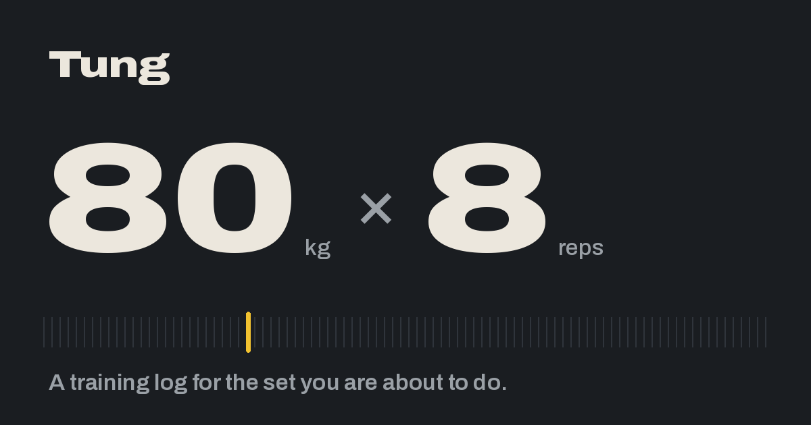
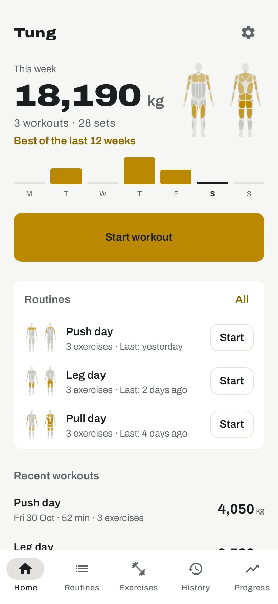
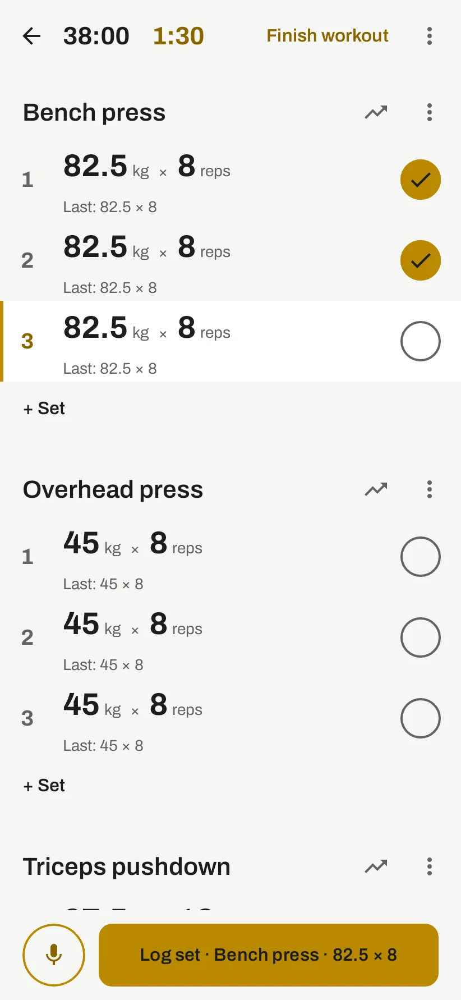
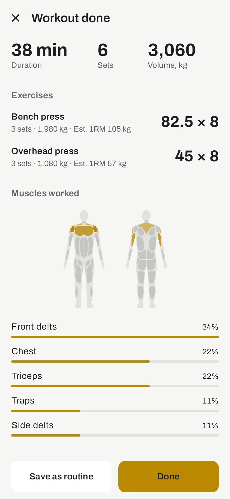

<p align="center">
  
</p>

<p align="center">
  <a href="https://tung.xuper.fun/"><b>Website</b></a> ·
  <a href="https://tung.xuper.fun/app/"><b>Web app</b></a> ·
  <a href="https://tung.xuper.fun/docs"><b>API docs</b></a> ·
  <a href="deploy/README.md"><b>Self-host</b></a>
</p>

<p align="center">
  <a href="https://github.com/kanylbullen/tung/actions/workflows/ci.yml"></a>
  <a href="LICENSE"></a>
  
  
</p>

**Tung** is Swedish for *heavy*. It is a strength training log for people
who lift: start a workout, enter weight and reps with one thumb between
sets, and see what you did last time right next to every set. Think Jefit,
but calmer, faster, and yours.

<p align="center">
  <picture>
    <source media="(prefers-color-scheme: dark)" srcset="server/src/main/resources/site/screens/home-dark.webp">
    
  </picture>
  <picture>
    <source media="(prefers-color-scheme: dark)" srcset="server/src/main/resources/site/screens/workout-dark.webp">
    
  </picture>
  <picture>
    <source media="(prefers-color-scheme: dark)" srcset="server/src/main/resources/site/screens/summary-dark.webp">
    
  </picture>
</p>

## Principles

- **The numbers are the content.** Weight and reps are set large, everything
  else stays quiet. One accent colour, one typeface, no decoration.
- **Last time, right there.** Every set shows the matching set from your
  previous session, and new sets are pre-filled from it. Jefit buries this;
  here it is the point.
- **Offline first.** Gyms have bad reception. The app works fully without a
  network or an account. A server is optional and adds sync, an API and MCP.
- **Your data is yours.** Nothing leaves the device unless you turn sync on,
  and there are no analytics and no ads. The server exports your whole log
  as JSON.
- **Everything except personal data is open.** The code, the server, the
  exercise catalogue and the documentation.

## What it does

**Logging**
- A sticky **Log set** button under the thumb, a huge input sheet with a
  ruler for weight and reps, and a rest timer that alerts you even with the
  screen off.
- The ongoing workout as a notification with Log set and Finish, shown as a
  Live Update chip on Android 16.
- Log a set by voice ("80 kilo 8"), in English and Swedish, on the device
  with no network.

**Planning**
- Routines and programs: fixed weekdays or a rotating split, with "Today" on
  the home screen.
- About 680 exercises by muscle group, filtered by the equipment you have,
  each with a muscle map and instructions.
- A smart picker that suggests the next exercise from your own habits.

**Progress**
- Estimated 1RM, top set and volume over time, weekly volume, streaks and
  records, and the muscles each workout and routine works.
- A sheet inside the workout that tells you whether the set you are about to
  do is a new record.

**Everywhere**
- **Wear OS:** log sets from the wrist. Linked to your server with a
  six-digit code, the watch keeps its own log and syncs over Wi-Fi, so the
  phone can stay in the locker. See [`wear/README.md`](wear/README.md).
- **Web:** an installable PWA that keeps your log in the browser and syncs
  like the phone. See [`web/README.md`](web/README.md).
- **Sync** with a tung-server, signed in with email and password or Google.
  Newest write wins, row by row, and push wakes your other devices.

**Bring your own**
- **Import from Jefit**, with a review of every exercise name it cannot
  match by itself.
- **Health Connect:** write your workouts and read heart rate and calories,
  each only when you turn it on.
- **An assistant with your own key** (OpenAI-compatible, Anthropic or a
  local Ollama) that suggests a program, your next workout or where you have
  stalled. The request goes straight from the phone to your provider, and
  the app shows what it sends before it sends it.

## The server

[`server/`](server/README.md) is optional, and the same image runs our
instance at [tung.xuper.fun](https://tung.xuper.fun/) and your own.

- **One command surface.** Every change the app makes is a command in
  `core/`, and the server exposes the same commands over REST and as MCP
  tools. A button and an assistant cannot drift apart.
- **REST API** with tokens and an OpenAPI spec, served as Swagger UI at
  `/docs`. A test fails when a route is missing from the spec.
- **MCP** with OAuth 2.1, so the assistant you already use (Claude, ChatGPT,
  a local model) can log a set, answer "what did I bench last time", or save
  a program it wrote from your history.
- **Self-hosting** with one Docker image and Postgres: `docker compose up` in
  [`deploy/`](deploy/README.md).

## Try it

- **On the web:** [tung.xuper.fun/app](https://tung.xuper.fun/app/), with
  an account on the server.
- **On Android and Wear OS:** in internal testing on Google Play. Sign up on
  [tung.xuper.fun](https://tung.xuper.fun/) with the email of your Google
  account.
- **From source:** see [Building](#building).

An iPhone app is in progress: `core` and `data` are Kotlin Multiplatform,
and the screens move to Compose Multiplatform next.

## Repository

| Path | What it is |
|---|---|
| [`core/`](core/) | Domain rules, commands, the sync protocol, progress and the import adapters. Kotlin Multiplatform, no Android. |
| [`data/`](data/) | Room, the repositories, sync, the rest timer and the ongoing notification, shared by the phone and the watch. |
| [`app/`](app/) | The Android phone app: Jetpack Compose and Material 3. |
| [`wear/`](wear/README.md) | The Wear OS app. |
| [`web/`](web/README.md) | The web app: Kotlin/JS with Compose HTML. |
| [`server/`](server/README.md) | tung-server: Ktor, Exposed and Postgres, with REST, sync and MCP. |
| [`catalog/`](catalog/README.md) | The exercise catalogue as open data, and the scripts that generate the app's seed and strings from it. |
| [`deploy/`](deploy/README.md) | Self-hosting with Docker Compose, and the Play release in [`deploy/play.md`](deploy/play.md). |
| [`docs/`](docs/architecture.md) | The architecture and the decisions behind it. |

## Building

You need JDK 21 and an Android SDK with platform 36. The Gradle wrapper
fetches the rest.

```sh
export JAVA_HOME=/path/to/jdk-21
export ANDROID_HOME=/path/to/android-sdk
echo "sdk.dir=$ANDROID_HOME" > local.properties   # once, gitignored
./gradlew assembleDebug test
```

- The phone's APK is `app/build/outputs/apk/debug/app-debug.apk`. On a
  phone, `./gradlew :app:assembleDogfood` gives a minified build that runs
  several times faster.
- `test` runs every module's tests. They include flow tests that drive the
  real screens under Robolectric, with no emulator.
- The server's tests start Postgres in Docker through Testcontainers.
  Without Docker, add `-x :server:test`.
- The web app is `./gradlew :web:jsBrowserDistribution`.
- On a machine that prefers IPv6, Gradle may fail to reach Maven. The
  repository already forces IPv4 in `gradle.properties`.

CI runs the same build on every pull request.

## Licence

The code is free software under **GNU AGPL-3.0-or-later**, see
[`LICENSE`](LICENSE). Anyone who runs a modified version as a service must
offer its source to its users.

The curated exercise catalogue is open data under CC0. The broader English
catalogue comes from [free-exercise-db](https://github.com/yuhonas/free-exercise-db)
under the Unlicense. The Archivo typeface is under the SIL Open Font
License. Your training data is yours.
